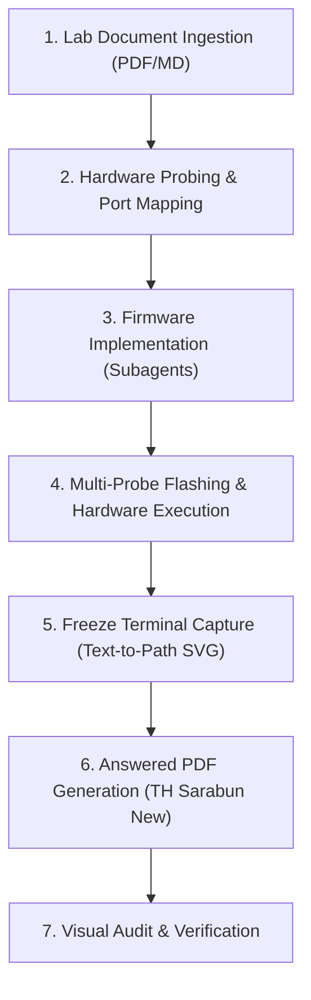

# FlatSat Lab End-to-End Solver Skill

This skill provides a standardized, fully automated runbook to implement, test, and document any KMITL FlatSat laboratory assignment using physical STM32 microcontroller hardware or simulations.

---

## Workflow Overview



---

## Step-by-Step Procedure

### Step 1: Ingest Lab Document & Inspect Requirements
1. Identify the input lab sheet PDF (e.g., `Exercise/FlatSat Labs Class <N>.pdf`).
2. Run an inspection script to locate:
   - **Terminal screenshot placeholders** (e.g., "ภาพ output จาก serial monitor").
   - **Performance / metric tables** (e.g., Throughput, Packet Error Rate, Watchdog recovery).
   - **Conclusion questions** (Questions 1–6 and Section 7 Conclusion).
3. Identify the required subsystems and MCUs (e.g., OBC: STM32F429ZI, COMMS: STM32F411RE, GroundStation: STM32F103RC, EPS, ADCS).

### Step 2: Probe Hardware & Generate `connections.json`
When multiple STM32 boards are connected via USB:
1. Run the hardware probe helper:
   ```bash
   .venv/bin/python .agents/skills/flatsat-lab-solver/scripts/probe_hardware.py
   ```
2. Verify probe serial numbers, device IDs, and serial ports.
3. Save or update `connections.json`. See [Hardware Mapping Reference](./references/hardware_mapping.md) for details on device IDs and FQBNs.

### Step 3: Implement Subsystem Firmware
1. Launch dedicated subagents for each subsystem exercise (e.g. OBC, COMMS, GroundStation).
2. Follow all TODOs and requirements in the exercise template.
3. Preserve existing code structure, comments, and libraries.

### Step 4: Compile & Flash Hardware
1. Compile using Arduino CLI with Generic STM32 FQBNs:
   - OBC: `STMicroelectronics:stm32:GenF4:pnum=GENERIC_F429ZITX`
   - COMMS: `STMicroelectronics:stm32:GenF4:pnum=GENERIC_F411RETX`
   - Ground Station: `STMicroelectronics:stm32:GenF1:pnum=GENERIC_F103RCTX`
2. Flash each specific board using its ST-Link probe serial number (`sn=<SN>`) via `STM32_Programmer_CLI`:
   ```bash
   STM32_Programmer_CLI -c port=SWD sn=<SN> -w build/<subsystem>.bin 0x08000000 -v -rst
   ```
3. Run the hardware mission over serial/RF channels.
4. Record raw terminal output logs into `artifact/logs/`.

### Step 5: Capture Terminal Outputs via Freeze (Text-to-Path Vector SVGs)
To prevent PyMuPDF from substituting `Times-Roman` (serif) due to missing WOFF2 support in PDF engines:
1. Use `freeze` to render terminal windows with macOS window controls and ANSI syntax highlighting.
2. Run the text-to-path converter to transform all text into 100% pure vector `<path d="...">` curves:
   ```bash
   .venv/bin/python -c "
   from capture_terminal import capture_terminal_output
   capture_terminal_output(lines, 'artifact/<name>.svg', width=888, height=<H>, font_size=13)
   "
   ```
3. See [Freeze Vector SVG Reference](./references/freeze_vector_svg.md) for full details on the glyph outline extraction algorithm.

### Step 6: Generate Answered PDF (`Lab_<N>_Answered.pdf`)
1. Use the generic PDF engine in [pdf_engine.py](./scripts/pdf_engine.py).
2. Insert pure vector SVGs into the target bounding boxes using `page.show_pdf_page(rect, svg_pdf, 0)`.
3. Render all Thai and English text answers with **TH Sarabun New** font (`fonts/THSarabunNew.ttf`) using 300 DPI HarfBuzz text shaping:
   - Text color: Royal Navy Blue `RGB(10, 40, 180)`
   - Numeric data color: Dark Slate Gray `RGB(30, 30, 30)`
   - Table observation font size: 9.0 pt
   - Questions font size: 9.5 pt
   - Conclusion font size: 8.0 – 8.2 pt (placed in dedicated open whitespace below line 660 to prevent prompt header collisions).
   - See [PDF Typography Reference](./references/pdf_typography.md) for detailed guidelines.

### Step 7: Verification & Audit
1. Render answered PDF pages to PNG and verify:
   - Zero rasterization on terminal boxes (confirm `get_images()` returns 0 raster images on terminal pages).
   - Zero font substitution (confirm no `Times-Roman` appears).
   - No text collisions or edge overflows in tables or conclusion sections.
   - CRC32/MD5 data verification matches 100% between transmitted and assembled files.

---

## Associated Tools & Files
- [probe_hardware.py](./scripts/probe_hardware.py): ST-Link probe and port scanner.
- [capture_terminal.py](./scripts/capture_terminal.py): Freeze terminal capture and text-to-path vectorizer.
- [pdf_engine.py](./scripts/pdf_engine.py): Multi-page PDF overlay engine with HarfBuzz shaping.
- [hardware_mapping.md](./references/hardware_mapping.md): MCU device IDs, FQBNs, and CLI commands.
- [freeze_vector_svg.md](./references/freeze_vector_svg.md): Vector SVG outline conversion mechanics.
- [pdf_typography.md](./references/pdf_typography.md): Thai text shaping and layout standards.

